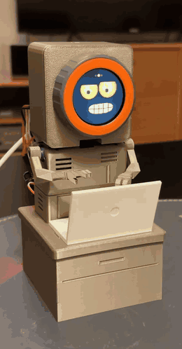
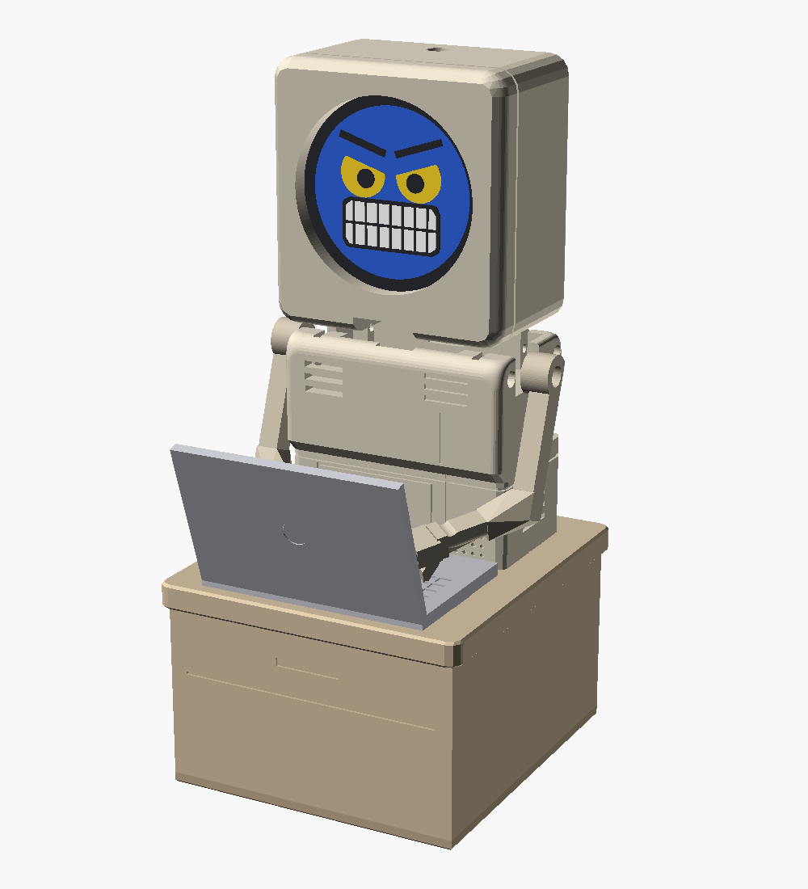

# M5Dial Little Engineer

A small 3D-printed desk robot that sits at its own desk and "works" on a laptop. Its head is an [M5Stack Dial](https://docs.m5stack.com/en/core/M5Dial), whose round screen shows an animated face. Three micro servos move the two arms and turn the head. While the robot "thinks", its eyes read the laptop screen and its arms type on the keyboard.

The robot is a remix of [Tiny Engineer](https://github.com/jamro/tiny-engineer) by jamro, redesigned for GH-S37D servos, an M5Dial head and a desk with the servo board built in. The project has two parts:

- **Firmware** (this folder): runs on the M5Dial and drives the face, sounds and servos.
- **3D models** ([`3d_models/`](3d_models/)): OpenSCAD sources and printable STLs for the robot, its desk and the laptop.

Firmware for the [M5Stack Dial](https://docs.m5stack.com/en/core/M5Dial) (ESP32-S3, round 240×240 display, rotary encoder, touch, RFID). It does these things:

- **Animated robot faces**: two styles ("bot" and "eyes") with ten expressions and matching sounds, plus cartoon "done" and "question" faces.
- **Typing arms**: the robot's two arm servos "type on a laptop" while the thinking face reads the screen.
- **One-word animations**: `thinking`, `done`, `question` and `sleep` set the face, sound and arm movement together.
- **Servo control**: the dial drives three hobby servos through a PCA9685 board on Port A, with a round gauge showing the angle.
- **RFID reader**: tap a card and its UID is shown on screen.
- **USB serial and Bluetooth LE commands**: the same command set over a USB cable or wirelessly, with `help` and `status` to find your way around.
- **Serial messages**: text sent over USB serial or BLE is shown as a message card.
- **Circular maze game**: a random maze of rings you play with the dial and button.

<p align="center"></p>

<p align="center"><a href="m5_dail_robot.mp4">Watch the video with sound (MP4)</a></p>

`face.sh` sends one command from the terminal and prints the reply. Words other than `sound`, `servo`, `arms`, `pwm`, `rotate`, `reset`, `thinking`, `done`, `question` and `sleep` are sent as a face command:

```sh
./face.sh thinking
./face.sh thinking 40 0.2 1.5
./face.sh bot happy
./face.sh sound done
./face.sh done
./face.sh question
./face.sh sleep
```

### Typing arms

`thinking` shows the thinking face and starts the typing arms. It takes the same optional speed and pause values as `arms thinking`, which starts only the arms (`face thinking` starts only the face). The arms type like the robot is working on a laptop:

- One keystroke at a time: a random arm presses and comes back up. Servo 1 rests at 135° and presses to 145°. Servo 3 rests at 40° and presses to 30°.
- After each keystroke there is a random pause.
- Every 6–15 s, servo 3 lifts to 80° at 30 deg/s, holds briefly and goes back, while servo 1 keeps typing.
- The head (servo 2) stays still. Set `HEAD_TURNS = true` to make it turn to a random angle between 85° and 95° at 40 deg/s every 2–10 s.
- All moves ease in and out to keep the servos quiet.

The angles and timings are at the top of the arm code in `m5dail_proj.ino` (`ARM_SWINGS`, `ARM_LIFT_*`, `HEAD_*`).

### Job done

`done` shows the "done" face (blue, eyes shut in happy arcs, big laughing mouth), plays the done bell and puts the arms in the done pose:

- Servo 1 moves to 120°.
- Servo 3 waves between 80° and 90°, switching every 2 s.
- All moves at 100 deg/s, eased in and out.

`arms done` starts only the pose and `face done` only the face. `arms off` ends the pose and eases the arms back to their default angles. The values are `DONE_*` in `m5dail_proj.ino`.

### Question

`question` shows the "question" face (eyes rolled up to the top right, one brow raised, a small "o" mouth and a big "?"), plays the question sound and rocks servo 1 like the robot is scratching its head:

- Servo 1 moves to 90° at 100 deg/s, then back to 110° at 30 deg/s, pauses 1 s, and repeats.
- Servo 3 and the head go to their default angles.

`arms question` and `face question` start only one part, and `arms off` ends the pose. The values are `QUESTION_*` in `m5dail_proj.ino`.

## The robot (3D model)

<p align="center"></p>

All parts are designed in OpenSCAD and print without supports, except the arms' hands. The STLs are in [`3d_models/parts/gh-s37d/stl/`](3d_models/parts/gh-s37d/stl/).

| Part | What it is |
|---|---|
| `HeadM5Dial` | Boxy head that holds the M5Dial as its face. It sits directly on the neck servo, which turns it left and right. |
| `Torso` | Body with pockets for the three servos: one per arm, and the neck in the middle. |
| `ArmLeft`, `ArmRight` | One-piece arms with robot claws, long enough to reach the laptop keys. They press onto the arm servos' shafts. |
| `DeskBox`, `DeskBase` | Closed desk the torso plugs into. The PCA9685 servo board sits inside, and the cables leave through a slot in the back. |
| `Laptop` | Open laptop that clips into the desk top in front of the robot. |
| `HeadSocketTest` | Small test print to find the best shaft socket size for your servos. |

Print settings, assembly steps and how to change the sizes are in [`3d_models/README.md`](3d_models/README.md).

## Hardware

| Part | Notes |
|---|---|
| M5Stack Dial | Main board |
| PCA9685 16-channel PWM board | On Port A (I2C, SDA=G13, SCL=G15), address `0x40`. The firmware also works if SDA and SCL are swapped. |
| 3 × GH-S37D servos | Servo N on PCA9685 channel N−1. Servos 1 and 3 are the arms. Pulse range 500–2500 µs, 50 Hz by default. Default angles: 125°, 90°, 50°. |
| External servo power | Power the servos from the PCA9685 V+ terminal, not from the Dial. |


See M5Stack's [M5Dial docs](https://docs.m5stack.com/en/core/M5Dial) for the pinout and specs.

## Building and flashing

Requirements:

- [`arduino-cli`](https://arduino.github.io/arduino-cli/)
- The **M5Stack** ESP32 board package (`m5stack:esp32`) and the `M5Dial` library

Always build with the Makefile:

```sh
make            # compile + flash
make compile    # compile only
make flash      # flash the last build
make verify     # check flash contents against build/ with esptool
make clean      # delete build/
make list       # list connected boards
```

The Makefile sets:

- `FQBN = m5stack:esp32:m5stack_dial`. Use the M5Stack package, not the generic `esp32:esp32:m5stack_dial`, which can flash without the new firmware taking effect.
- `PORT = /dev/cu.usbmodem1101`. Change this if your Dial shows up on a different port (`make list`).

At boot the screen shows the build date and a build hash for 1.5 seconds, so you can check that a new flash took effect.

## Using it

### Face mode (at power-on)

The Dial starts on the bot "thinking" face.

- **Tap the screen**: next expression.
- **Hold the button**: go to servo mode.

Expressions: happy, sad, surprised, angry, excited, confused, thinking, winking, love, sleeping, done, question. In the thinking face the eyes look down and read lines of text, like reading a laptop screen.

### Servo mode

- **Turn the dial**: move the active servo (0–180°).
- **Tap the screen**: switch to the next servo (1 → 2 → 3).
- **Hold an RFID card near the Dial**: show its UID.
- **Press the button**: start the maze game.

If no PCA9685 is found, the gauge shows `NO PCA9685`.

### Maze game

You start in the center and need to reach the exit (marked green) on the outer ring. The exit is always the cell farthest from the start.

- **Turn the dial**: pick a direction. The arrow shows the direction you picked.
- **Press the button**: move. The player keeps following the corridor until it reaches a junction, a dead end, or another ring.
- After escaping, press the button again to go back to servo mode.

## Commands (USB serial and Bluetooth LE)

Commands ignore case (`Face Happy` = `face happy`). Type `help` for the list and `help <command>` for details and examples.

Over USB, connect at 115200 baud, or run the included monitor:

```sh
pip install pyserial
python3 serial_monitor.py
```

The same commands work over Bluetooth LE. The robot shows up as `M5Dial-Robot`. Service `6E400001-B5A3-F393-E0A9-E50E24DCCA9E` has one characteristic, `6E400002-B5A3-F393-E0A9-E50E24DCCA9E`, that supports:

- **write**: send a command (each write is one command)
- **notify**: get every line the robot prints, as it happens
- **read**: get the full output of the last command (up to 512 bytes)

Any generic BLE app works (nRF Connect, LightBlue). Output goes to USB serial and every connected BLE client. From a computer (type `?` to do a read):

```sh
pip install bleak
python3 ble_monitor.py
```

| Command | What it does |
|---|---|
| `help [command]` | List commands, or show details and examples for one command |
| `status` | Mode and face, servo angles, arms, sound, BLE clients, RFID, uptime and build |
| `servo <1-3> <0-180> [deg/s]` | Set a servo angle. With a speed it moves there smoothly, without it jumps. |
| `arms thinking [deg/s] [min s] [max s]` | Start the typing arms (see below). Defaults: 100 deg/s, pause 0.1–1 s. One pause value = fixed pause. |
| `thinking [deg/s] [min s] [max s]` | Thinking face + typing arms |
| `done` | Done face, done sound and done arm pose |
| `question` | Question face, question sound and question arm pose |
| `sleep` | Eyes-style sleeping face, arms back to their default angles |
| `arms done`, `arms question` | Only the arm pose |
| `arms off` | Finish the current keystroke, then return the arms to their default angles |
| `face [bot\|eyes] <name\|cycle\|off>` | Show an expression. `face` alone lists them. |
| `sound <name\|stop\|vol N>` | Play a sound. `sound typing [seconds] [speed]` plays keyboard clicks. `sound` alone lists them. |
| `pwm <40-330>` | Servo PWM frequency in Hz (default 50, resets at power-on) |
| `rotate <0-3>` | Rotate the screen in 90° steps |
| `reset` | Stop the arms and move all servos to their default angles |
| `pca` | Dump PCA9685 registers and channel values |
| `scan` | Debug Port A: check line levels, scan the I2C bus, re-init the PCA9685 |
| anything else | Show the text on screen as a message (up to 80 characters) |

## Files

| File | Purpose |
|---|---|
| `m5dail_proj.ino` | Firmware |
| `faces.h` | Animated faces |
| `sounds.h` | Sounds |
| `face.sh` | Send one serial command from the terminal |
| `Makefile` | Build, flash and verify |
| `serial_monitor.py` | Two-way serial terminal |
| `ble_monitor.py` | Two-way Bluetooth LE terminal |
| `circular_maze.py` | Desktop Python prototype of the maze (matplotlib). Arrow keys pick a direction, space moves. |
| `circular_maze.png` | Screenshot of the prototype |
| `3d_models/` | Robot, desk and laptop: OpenSCAD sources, STLs and renders ([details](3d_models/README.md)) |
