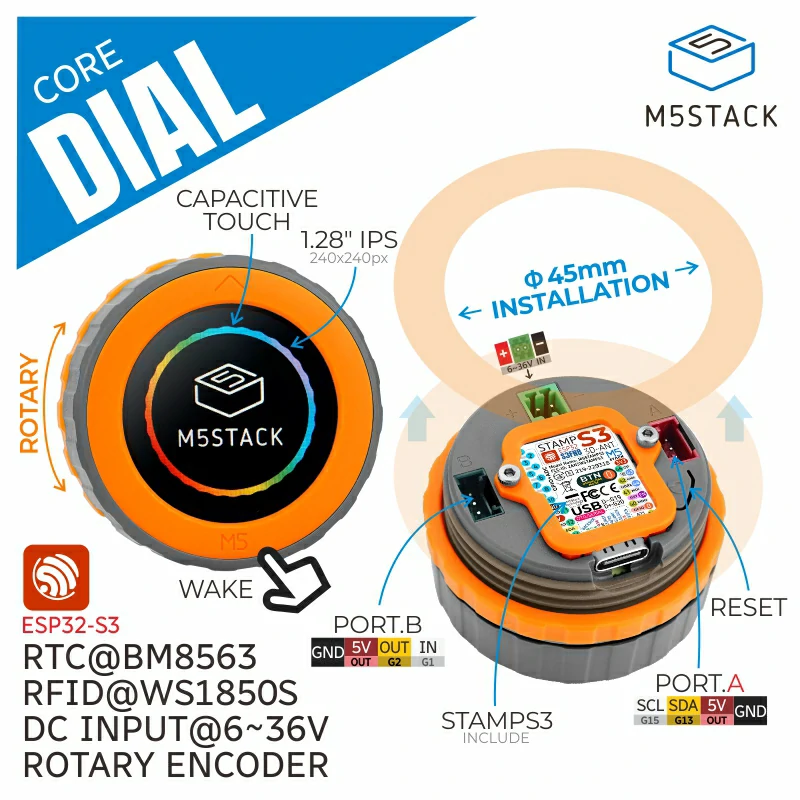
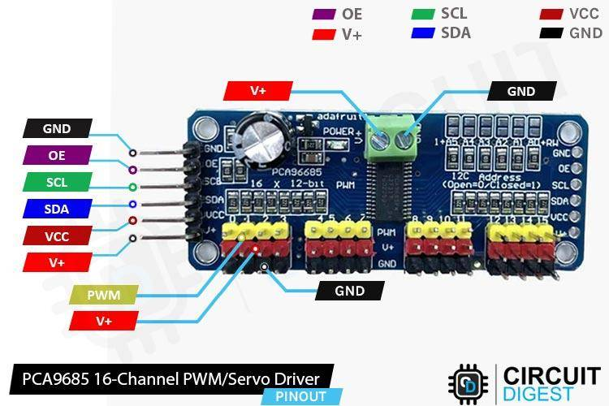

# M5Dial Project

Firmware for the [M5Stack Dial](https://docs.m5stack.com/en/core/M5Dial) (ESP32-S3, round 240×240 display, rotary encoder, touch, RFID). It does four things:

- **Servo control**: the dial drives two hobby servos through a PCA9685 board on Port A, with a round gauge showing the angle.
- **RFID reader**: tap a card and its UID is shown on screen.
- **Serial messages**: text sent over USB serial is shown as a message card.
- **Circular maze game**: a random maze of rings you play with the dial and button.



## Hardware

| Part | Notes |
|---|---|
| M5Stack Dial | Main board |
| PCA9685 16-channel PWM board | On Port A (I2C, SDA=G13, SCL=G15), address `0x40`. The firmware also works if SDA and SCL are swapped. |
| 2 × hobby servos | Servo 1 on PCA9685 channel 0, servo 2 on channel 1. Pulse range 500–2500 µs, 50 Hz. |
| External servo power | Power the servos from the PCA9685 V+ terminal, not from the Dial. |



`m5dail.pdf` has the M5Dial reference sheet.

## Building and flashing

Requirements:

- [`arduino-cli`](https://arduino.github.io/arduino-cli/)
- The **M5Stack** ESP32 board package (`m5stack:esp32`) and the `M5Dial` library

Always build with the Makefile:

```sh
make            # compile + flash
make compile    # compile only
make flash      # flash the last build
make verify     # check flash contents against build/ with esptool
make clean      # delete build/
make list       # list connected boards
```

The Makefile sets:

- `FQBN = m5stack:esp32:m5stack_dial`. Use the M5Stack package, not the generic `esp32:esp32:m5stack_dial`, which can flash without the new firmware taking effect.
- `PORT = /dev/cu.usbmodem1101`. Change this if your Dial shows up on a different port (`make list`).

At boot the screen shows the build date and a build hash for 1.5 seconds, so you can check that a new flash took effect.

## Using it

### Servo mode (default)

- **Turn the dial**: move the active servo (0–180°).
- **Tap the screen**: switch between servo 1 and servo 2.
- **Hold an RFID card near the Dial**: show its UID.
- **Press the button**: start the maze game.

If no PCA9685 is found, the gauge shows `NO PCA9685`.

### Maze game

You start in the center and need to reach the exit (marked green) on the outer ring. The exit is always the cell farthest from the start.

- **Turn the dial**: pick a direction. The arrow shows the direction you picked.
- **Press the button**: move. The player keeps following the corridor until it reaches a junction, a dead end, or another ring.
- After escaping, press the button again to go back to servo mode.

## Serial commands

Connect at 115200 baud, or run the included monitor:

```sh
pip install pyserial
python3 serial_monitor.py
```

| Command | What it does |
|---|---|
| `help` | List commands |
| `status` | Print current state, encoder value and last RFID UID |
| `servo <1\|2> <0-180>` | Set a servo angle |
| `reset` | Center both servos (90°) |
| `pca` | Dump PCA9685 registers and channel values |
| `scan` | Debug Port A: check line levels, scan the I2C bus, re-init the PCA9685 |
| anything else | Show the text on screen as a message (up to 80 characters) |

## Files

| File | Purpose |
|---|---|
| `m5dail_proj.ino` | Firmware |
| `Makefile` | Build, flash and verify |
| `serial_monitor.py` | Two-way serial terminal |
| `circular_maze.py` | Desktop Python prototype of the maze (matplotlib). Arrow keys pick a direction, space moves. |
| `circular_maze.png` | Screenshot of the prototype |
